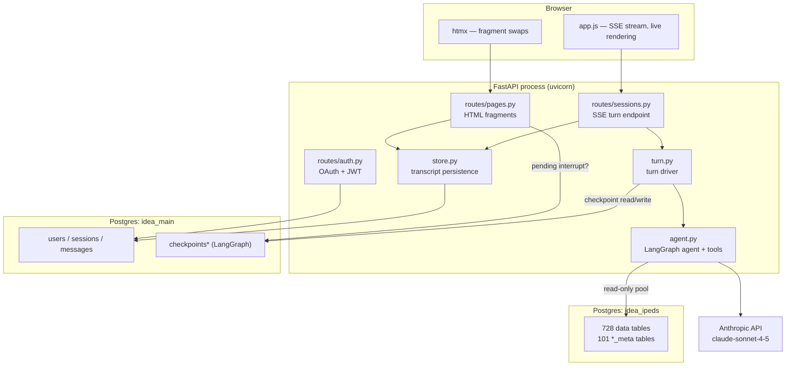
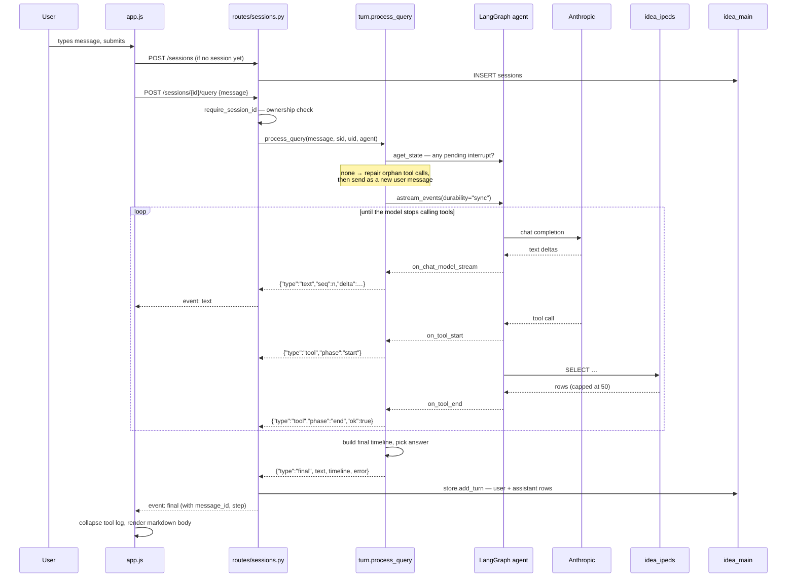
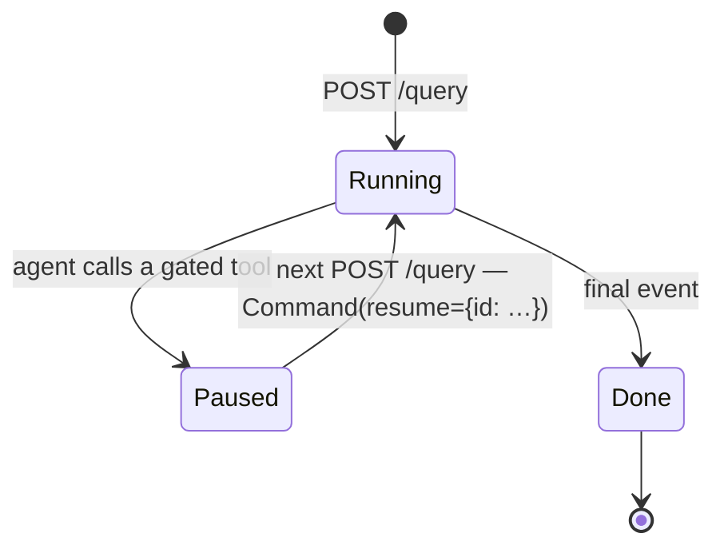
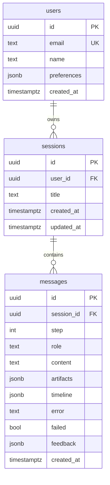

# IDEA — Design Document

**IPEDS Data Exploration Assistant**
Status: draft · Version: `v0.2.0-agents` · Last updated: 2026-08-21

---

## 1. What the system is

IDEA lets journalists ask questions in English about 20 years of U.S.
higher-education data (IPEDS, collection years 2004-05 through 2023-24) and get
answers grounded in the actual survey tables — without writing SQL.

The core of the system is a single LLM agent with read-only SQL access. The
agent is not given a schema dump; it is given *tools to discover the schema*,
because IPEDS is too large (728 data tables across 20 years) to fit in a prompt
and its column meanings drift year to year. The system prompt therefore encodes
a research method — look up the table, look up the variable, look up the
categorical value set, then query — rather than a fixed query template.

Two properties drive most of the design:

1. **The agent may need to ask a question back.** "Enrollment at Tech" is
   ambiguous. The agent can pause mid-turn and wait for the user, which means a
   turn is not a request/response pair — it is a resumable process.
2. **The browser is never the source of truth.** A reload, a stale tab, or a
   dropped connection must not corrupt a conversation. Whether a thread is
   paused, and what it is paused on, is always read back from Postgres.

### Non-goals (current build)

- No arbitrary code execution. The agent writes SQL, not pandas. (The README
  still describes an earlier codegen pipeline; see §8.)
- No chart or file generation yet — the `artifacts` field exists and is always
  empty.
- No multi-user sharing. Sessions are strictly per-user.

---

## 2. Architecture



### 2.1 Layers

| Layer | Files | Responsibility |
|---|---|---|
| Presentation | `frontend/` | Server-rendered Jinja shell + htmx fragments; `app.js` owns only the SSE turn loop |
| HTTP | `backend/app/routes/` | Three routers: pages (HTML), auth (OAuth/JWT), sessions (JSON + SSE) |
| Turn orchestration | `turn.py` | Decides start-vs-resume, drives the graph, normalizes events into a timeline |
| Agent | `agent.py` | LangGraph agent definition, system prompt, five IPEDS tools + `ask_user` |
| Persistence | `store.py`, `models.py`, `db.py` | Transcript CRUD; ORM→DTO mapping so Jinja never touches lazy relationships |
| Config | `config.py` | Env parsing, allowlist, URL normalization, fail-fast on missing `JWT_SECRET` |
| Offline | `db_setup/` | One-time IPEDS download → Access → Postgres ingest, plus LLM description summarization |

### 2.2 Key architectural decisions

**Two databases, not two schemas.** `idea_main` holds application state and is
read-write; `idea_ipeds` holds survey data and is opened with
`default_transaction_read_only=on` at the connection level. The separation means
no agent-issued SQL can reach user data even if the string-prefix check in
`execute_readonly_sql` is defeated.

**Three connection pools, three drivers.** They are not interchangeable:

| Pool | Driver | Used by | Why separate |
|---|---|---|---|
| SQLAlchemy async engine (`db.py`) | asyncpg | app tables | ORM + async request path |
| `AsyncConnectionPool` (`main.py`) | psycopg 3 | LangGraph checkpointer | `AsyncPostgresSaver` requires psycopg 3, `autocommit`, `dict_row` |
| `ConnectionPool` (`agent.py`) | psycopg 3 (sync) | IPEDS tools | Tools run in executor threads; read-only session options |

`config.py` rewrites URLs per driver — `+asyncpg` added for SQLAlchemy, stripped
for the checkpointer.

**State lives in the checkpoint, not the client.** LangGraph's
`AsyncPostgresSaver` stores each thread's full message history, keyed by
`thread_id == str(session.id)`. Two consequences the code leans on hard:
- The agent never needs the transcript replayed to it — `get_thread_config()` is
  enough.
- "Is this session waiting on an answer?" is answered by
  `pending_interrupt()` reading `StateSnapshot.interrupts`, both when rendering
  a page (`frag_session`) and when accepting a message (`process_query`).

**Schema is created at startup, not migrated.** `create_schema()` in `db.py`
runs `Base.metadata.create_all` under an advisory lock, and `models.py` is the
only source of truth for the schema. It only ever CREATEs — adding a column
needs a hand ALTER or a dev rebuild. There is no migration tool in the
project.

---

## 3. Flow of events for a user request

### 3.1 The happy path



### 3.2 The turn timeline

A turn is modelled as an **ordered list of what the agent said and did**:

```json
[{"kind": "text", "text": "I'll find the right table first."},
 {"kind": "tool", "name": "get_table_descriptions_by_year", "ok": true},
 {"kind": "text", "text": "EFFY2023 has it. Pulling totals."},
 {"kind": "tool", "name": "execute_readonly_sql", "ok": true},
 {"kind": "text", "text": "Texas gained the most, at +41,200 …"}]
```

**The rule:** if the turn succeeded and the last entry is text, that entry is
the answer — rendered as the message body and omitted from the activity log.
Everything before it is log content. A turn that ends on a tool entry has no
answer, and neither does a failed one (a half-written sentence from a died
stream is not something the model finished saying).

That rule is implemented **three times and must stay in step**:

| Where | What it drives |
|---|---|
| `turn.process_query` | picks `final.text` |
| `store.Message.log_entries` | server-side reload rendering |
| `app.js` `handleEvent` final branch | live rendering |

If they diverge, a message card visibly changes shape when the page reloads.
This is the single most fragile invariant in the codebase.

### 3.3 SSE event contract

| Event | Payload | Meaning |
|---|---|---|
| `status` | `{text}` | Transient chatter ("thinking…"); disappears at end of turn, never persisted |
| `text` | `{seq, delta}` | Token delta; `seq` is the index into the timeline |
| `tool` | `{phase, name, run_id, ok}` | Tool lifecycle; `run_id` pairs start with end |
| `clarify` | `{question, message_id, step}` | Turn paused awaiting an answer |
| `final` | `{text, timeline, artifacts, error, message, message_id, failed, step}` | Turn complete |

A turn ends on **either** `clarify` or `final`, never both.

Streaming plumbing: `StreamingResponse` with `Cache-Control: no-cache` and
`X-Accel-Buffering: no` — any proxy that buffers the body holds back the whole
answer and undoes the streaming. The client uses `fetch` + a manual SSE parser
rather than `EventSource`, which cannot POST.

### 3.4 Clarification and approval (human-in-the-loop)

`HumanInTheLoopMiddleware(interrupt_on=INTERRUPT_ON)` pauses the graph *before*
a gated tool's body runs. `astream_events` then completes normally without
raising, so `process_query` probes for a pending interrupt **after** the stream
loop — on both the success and error paths.

Two tools are gated, and they differ only in what the human may answer with:

| Tool | Allowed decisions | The turn ends on | Answered by |
|---|---|---|---|
| `ask_user` | `respond` (and the rest) | `clarify` | typing into the composer |
| `save_user_preference` | `approve` / `reject` | `confirm` | clicking Approve/Reject |

`turn.py` branches on the paused tool's `allowed_decisions`, read off the live
interrupt, rather than on its name — so a third gated tool needs no change there.
A rejected call gets a synthetic error `ToolMessage` and the body never runs;
only an approved one executes.



Two deliberate choices here:

- **One endpoint.** A fresh message and an answer to a pending question both
  POST to `/query`. Whether to start or resume is read from the checkpoint,
  never taken from the client — a stale tab cannot guess wrong.
- **The resume value is keyed by interrupt id.** A bare value also reaches
  `interrupt()`, but the map pairs each answer with the interrupt it answers, so
  a second pending question resolves instead of raising.

The paused question is persisted like any other answer (trailing text entry), so
a reloaded card matches what streamed. `frag_session` re-derives
`pending_question` from the checkpoint and stamps `data-clarify-pending` on the
message list; `app.js` reads it back on `htmx:afterSwap` to restore the
composer.

### 3.5 Failure and recovery

| Failure | Handling |
|---|---|
| Browser reload mid-turn | SSE request aborts → generator cancelled. `durability="sync"` means the last completed step is already checkpointed |
| Tool call committed but result never written | Next turn's `repair_orphan_tool_calls` appends a synthetic error `ToolMessage` — otherwise the provider rejects every later turn (`tool_use` with no `tool_result`) |
| Stream fails *after* the graph paused | Interrupt probe runs on the error path too; a discovered question wins over reporting the error |
| Graph stops with no final text | `error = "The agent stopped before answering."` rather than persisting an empty answer |
| SQL error | Returned to the model as a string; it retries or reports |

Repair only runs when `pending_interrupt` returned `None` — a live interrupt is
also an unanswered tool call, and "repairing" it would discard the question.

### 3.6 Auth flow

Google OAuth via Authlib → allowlist check (`config.ALLOWED_EMAILS`, ~30 hand-
maintained addresses) → `get_or_create_user` → HS256 JWT in an httpOnly cookie
(`dw_session`, 8h). `SessionMiddleware` exists solely to hold the OAuth state
token across the redirect round-trip. `DEV_AUTH_BYPASS=1` enables
`/auth/dev-login`, which issues the same JWT for any allowlisted email with no
Google round-trip; it 404s otherwise.

---

## 4. Database schema

### 4.1 `idea_main` — application tables



**`users`** — `UNIQUE(email)` doubles as the race guard in `get_or_create_user`.
Rows are inserted on first login. `preferences` holds `{"items": [str, …]}` —
standing instructions the agent gets in its system prompt on every turn, written
either by the preferences modal or by the `save_user_preference` tool once the
user approves it. Plain JSONB is not mutation-tracked, so `store.set_preferences`
always assigns the whole value.

**`sessions`** — `title` defaults to `"New Analysis"` and is overwritten with the
first 60 chars of the first message. `INDEX ix_sessions_user_updated (user_id,
updated_at)` serves the sidebar's ordered listing. `ON DELETE CASCADE` from
users.

**`messages`** — two rows per turn (`role='user'`, `role='assistant'`) sharing
one `step` ordinal.

| Column | Notes |
|---|---|
| `step` | 1-based turn ordinal, `max(step)+1` at insert; shared by the pair |
| `content` | User text, or the assistant's answer (empty on a failed turn) |
| `timeline` | The ordered trace from §3.2. The interesting column |
| `artifacts` | Reserved for charts/tables. **Always `[]` today** |
| `error` / `failed` | `failed = bool(error)`; error renders as the body |
| `feedback` | `{rating:int, issue_type:str, comment:str}` from the rate modal |

`INDEX ix_messages_session_step (session_id, step)`. Ordering is
`(step, created_at)`, which is what `ordered_messages` sorts by when
flattening messages for the template (role-branched, not pair-grouped).

### 4.2 `idea_main` — LangGraph checkpoint tables

Created by `checkpointer.setup()`, owned by the library, not by our models:

| Table | Contents |
|---|---|
| `checkpoints` | One row per graph step; carries a `metadata` column (we stash `user_id` there as an audit aid) |
| `checkpoint_blobs` | Serialized channel values — the actual message history |
| `checkpoint_writes` | Pending writes per step |
| `checkpoint_migrations` | Library's own version bookkeeping |

Keyed by `thread_id = str(session.id)`, always in canonical UUID form — the
delete path keys its purge on exactly that spelling.

**Deletion order matters.** `DELETE /sessions` purges checkpoints *first*, then
the session row. The two pools cannot share a transaction, so if the purge
fails, the session row survives and a retry converges. The reverse order would
strand checkpoint rows with no id left to find them by. If the checkpointer is
unavailable, the endpoint 503s rather than deleting half the record.

### 4.3 `idea_ipeds` — survey data (read-only at runtime)

Populated offline by `db_setup/ingest.py`. Currently **728 data tables** and
**63 metadata tables** (`tables`/`vartable`/`valuesets` x 20 years, plus
`newvariables` for the three years that have it).

**Data tables** keep IPEDS names, lowercased, with the year embedded:
`hd2023` (institutional directory), `effy2023` (enrollment), etc. Types come
from `mdb-schema` on the Access file, not CSV sampling, so a column has the same
type across every year. `DRV*`/`DFR*` derived rollups are skipped.

**Metadata tables** carry a `_meta` suffix and a two-digit year:

| Table | Contents |
|---|---|
| `tables<YY>_meta` | Every table that year + description (+ `description_summary` after postprocess) |
| `vartable<YY>_meta` | Every variable: name, title, long description, order (+ `longdescription_summary` after postprocess_columns) |
| `valuesets<YY>_meta` | Allowed codes and labels for categorical columns |
| `newvariables<YY>_meta` | Variables introduced that year (not present for all years) |
| `surveys<YY>_meta` | One row per survey component that year + an LLM survey summary. Written by `postprocess.py`, not by the ingest. |

Metadata comes from the `IPEDS<YYYY><YY+1>Tablesdoc.xlsx` workbook inside each
zip, **not** from the Access file: NCES revises the workbook but not the Access
copy, so the accdb catalogs carry stale year labels (Tables19 titles EF2019 as
"Fall 2017").

Because this database is written only offline, the app memoizes metadata-table
lookups (`_meta_table_cache`, `_has_column_cache`) for the process lifetime.

---

## 5. Agent tools

| Tool | Purpose |
|---|---|
| `get_meta_tables_by_year(year)` | Which metadata tables exist for a year |
| `get_table_descriptions_by_year(year)` | Table → description map; prefers the LLM-summarized description |
| `get_column_descriptions_of_table(year, table)` | Variable → {number, title, long description} |
| `lookup_valueset(year, table, var_name)` | Code → label for a categorical column |
| `execute_readonly_sql(sql)` | The actual query. `SELECT`/`WITH` only, 50-row cap with explicit truncation notice |
| `ask_user(question)` | Never executes — the middleware interrupts on it |
| `save_user_preference(preference)` | Gated on approval; runs only if the user approves |

Safety is layered: read-only database URL → `default_transaction_read_only=on`
per connection → statement-prefix check in the tool → 50-row cap so a runaway
`SELECT *` cannot blow the context window. `MAX_ROWS` is interpolated into the
tool description so the advertised cap cannot drift from the enforced one.

Year arguments go through `_two_digit_year`, which rejects anything outside
2000–2100 — without it, `str(23)[2:]` yields `''` and the `LIKE` patterns match
every year's metadata at once.

---

## 6. Repository structure

```
idea/
├── backend/app/
│   ├── main.py           # app factory, lifespan: schema + pools + agent build
│   ├── config.py         # env, allowlist, URL driver normalization
│   ├── db.py             # SQLAlchemy async engine, create_schema()
│   ├── models.py         # ORM: User, Session, Message
│   ├── store.py          # transcript CRUD + DTOs + pair_turns
│   ├── deps.py           # auth dependencies, ownership checks
│   ├── auth.py           # JWT issue/verify, Authlib OAuth registration
│   ├── agent.py          # agent definition: prompt, IPEDS tools, middleware
│   ├── turn.py           # turn driver: interrupts, repair, timeline, events
│   └── routes/
│       ├── pages.py      # HTML shell + htmx fragments
│       ├── auth.py       # /auth/login, /callback, /dev-login, /logout
│       └── sessions.py   # /sessions CRUD, SSE /query, /feedback
├── frontend/
│   ├── index.html        # app shell
│   ├── login.html
│   ├── fragments/        # htmx targets: sessions, main, rate, delete, welcome
│   └── static/           # app.js, styles.css, htmx, marked, DOMPurify (vendored)
├── db_setup/
│   ├── ingest.py         # download → extract accdb → load data + metadata
│   ├── postprocess.py    # Azure OpenAI summarization of table descriptions,
│   │                     # grouped by (year, survey)
│   └── postprocess_columns.py  # the same for the long column descriptions, one
│                         # call per distinct text rather than per row
├── data/{zips,accdb}/    # downloaded artifacts (gitignored)
├── data/summaries/       # postprocess output banked as CSV; --from-csv reloads
│                         # it after a rebuild without re-calling the model
├── docs/design.md        # this file
├── Dockerfile            # python:3.12-slim, uv, non-root uid 10001
├── docker-compose.yml    # app container → host Postgres via host.docker.internal
└── pyproject.toml        # uv-managed; Python >=3.12
```

### Conventions worth knowing

- **DTOs, not ORM objects, cross into templates.** Jinja renders synchronously;
  touching a lazy relationship there raises `MissingGreenlet`. `store.py` maps
  ORM → dataclass at the boundary.
- **Comments explain *why*, at length, where a change would silently break
  something.** The dense comments in `turn.py`, `sessions.py`, and `app.js` are
  load-bearing documentation of invariants, not clutter.
- **Frontend libraries are vendored**, not CDN-loaded. `marked` output is always
  passed through DOMPurify — the source is model output and `marked` passes raw
  HTML through by design.

---

## 7. Deployment

Single container, `uvicorn backend.app.main:app` on :8000, non-root uid 10001.
Dependencies are installed in a layer before source is copied, so editing
`backend/` or `frontend/` does not invalidate the `uv sync`.

| Variable | Required | Notes |
|---|---|---|
| `JWT_SECRET` | **yes** | No default — import fails without it |
| `MAIN_DATABASE_URL` | yes | App tables |
| `IPEDS_DATABASE_URL` | yes | Survey data |
| `CHECKPOINT_DATABASE_URL` | no | Defaults to `MAIN_DATABASE_URL` minus the asyncpg driver |
| `ANTHROPIC_API_KEY` | yes | Read by langchain-anthropic |
| `AGENT_MODEL` | no | Defaults to `anthropic:claude-sonnet-4-5` |
| `GOOGLE_CLIENT_ID` / `SECRET` / `REDIRECT_URI` | prod | OAuth |
| `COOKIE_SECURE` | no | Defaults to `1` |
| `DEV_AUTH_BYPASS` | no | Defaults to `0` |

Health check: `GET /health` → `{"status": "ok", "version": …}`.

---

## 8. Known gaps and open questions

| Item |
|---|
| **No rate limiting or per-user cost ceiling** on the agent loop. The recursion limit is the only bound on tool calls per turn. |
| **Concurrency within one session is undefined.** Two tabs posting to the same `session_id` hit the same checkpoint thread. **[TODO]** decide: reject, queue, or last-write-wins. |
