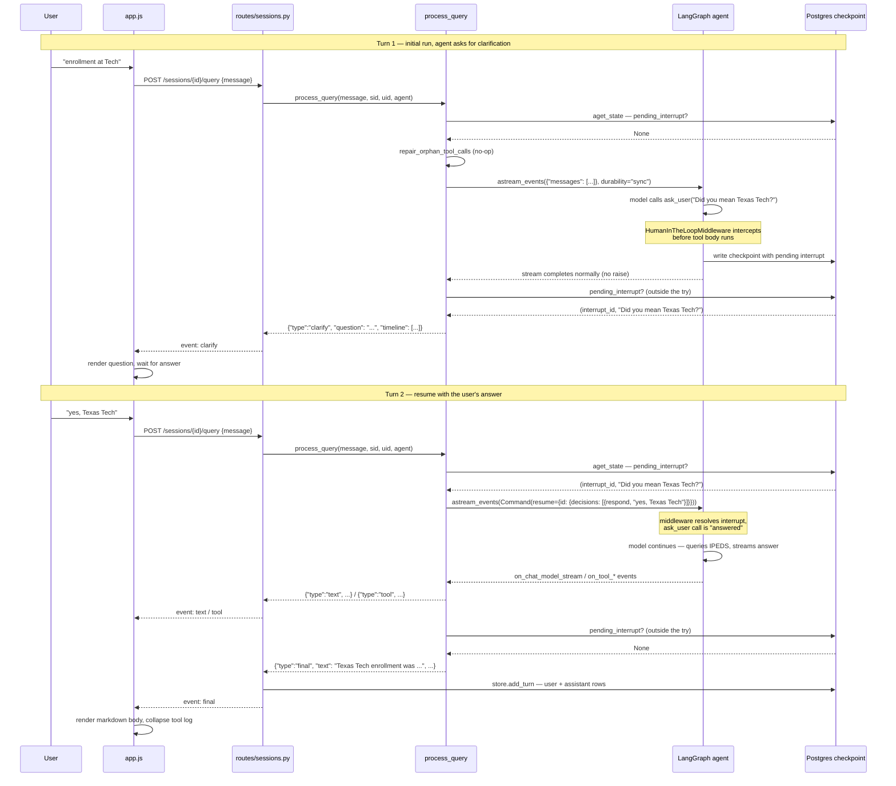

# Interrupts & Human-in-the-Loop — Deep Dive

**How a gated tool pauses the agent, how the server resumes it, and why every
piece of that server-side handling is load-bearing.**

Two tools are gated, and the difference between them is only what the human
answers with. `ask_user` allows a `respond` decision, so the answer is text
typed into the composer and the turn ends on a `clarify` event.
`save_user_preference` allows `approve` / `reject`, so the answer is a button
click and the turn ends on a `confirm` event. `turn.py` tells them apart by the
paused tool's `allowed_decisions`, read off the live interrupt, never by name —
`Pending.is_clarify` is that test. Everything below describes `ask_user`; the
approval path differs only in the decision it sends back.

This document deepens §3.4 of `design.md`, which covers the same flow at
architectural level. Read that for context; read this for the mechanism.

---

## 1. The interrupt contract

The agent has a tool called `ask_user`. **Its body never executes.** At
compile time the agent is wired with `HumanInTheLoopMiddleware` configured to
interrupt on that tool:

```python
# agent.py
def build_agent(checkpointer: AsyncPostgresSaver):
    """IPEDS analysis agent with a Postgres-backed checkpointer - indexed by thread_id"""
    return create_agent(
        model=AGENT_MODEL,
        tools=TOOLS,
        system_prompt=SYSTEM_PROMPT,
        checkpointer=checkpointer,
        middleware=[
            HumanInTheLoopMiddleware(interrupt_on={"ask_user": True}),
            ContextEditingMiddleware(...),
        ],
    )
```

The tool itself is a stub — it exists only to give the model a callable name
and a docstring that tells it *when* to ask:

```python
# agent.py
@tool
def ask_user(question: str) -> str:
    """Ask the user to clarify abbreviations, ambiguous terms, or unclear
    requests. Use this whenever the user's objective is ambiguous and you
    cannot proceed confidently without clarification."""
    return ""
```

When the model calls `ask_user`, the middleware intercepts the call *before*
the tool body runs and pauses the graph. The pause is recorded in the
checkpoint as a pending interrupt. The tool's `return ""` line is never
reached on the interrupt path — the resume value supplied by the user takes
its place.

The single most important design principle in this whole flow:

> **The checkpoint is the source of truth for whether a thread is paused —
> never the browser.**

A reload wipes any client-side flag. A stale tab holds stale state. A dropped
connection leaves the client with nothing. So the server reads interrupt state
back from Postgres on every turn, and on every page render. Everything below
follows from that.

---

## 2. Prerequisites

Two things must be in place for interrupts to work at all:

1. **A checkpointer.** The graph must be compiled with a checkpointer — here
   `AsyncPostgresSaver` (passed into `build_agent`). Without one there is
   nowhere to persist the paused state, and a pause is just a crash.

2. **A `thread_id` in the config.** The checkpointer keys every checkpoint by
   `configurable.thread_id`. In this repo the thread id *is* the session id,
   in canonical `str(uuid)` form:

```python
# turn.py
def get_thread_config(thread_id: str, user_id: str | None = None) -> dict[str, Any]:
    """The LangGraph config for one session's checkpoint thread."""
    configurable = {"thread_id": thread_id}
    if user_id is not None:
        configurable["user_id"] = user_id
    return {"configurable": configurable, "recursion_limit": RECURSION_LIMIT}
```

`thread_id` is the session id in canonical `str(uuid)` form — the delete flow
purges checkpoints by that exact spelling. `user_id` only lands in the
checkpoint `metadata` column as an audit aid, and must be a `str`: LangGraph
drops a raw UUID from `configurable` silently.

`process_query` calls this at the top of every turn. The resulting config is
what every checkpoint read/write — including interrupt detection — keys off.

---

## 3. Lifecycle: request → pause → resume

A clarification cycle has five phases. Each is a concrete code path.

### 3.1 Initial run — is there a pending interrupt?

The very first thing `process_query` does is ask the checkpoint whether this
thread is already paused:

```python
# turn.py
pending = await pending_interrupt(agent, config)
```

`pending_interrupt` reads `StateSnapshot.interrupts` and extracts the
interrupt id and the question text:

```python
# turn.py
async def pending_interrupt(agent, config) -> tuple[str, str] | None:
    """``(interrupt_id, question)`` if the thread is paused on ask_user, else None."""
    state = await agent.aget_state(config)
    for interrupt in state.interrupts:
        value = interrupt.value if isinstance(interrupt.value, dict) else {}
        requests = value.get("action_requests") or []
        if requests:
            question = requests[0].get("args", {}).get("question", "")
            return interrupt.id, question
    return None
```

Read from the checkpoint, never from the browser: a reload wipes any
client-side flag, and a client that then sends a fresh message instead of a
resume strands the `ask_user` call with no `ToolMessage` — which the provider
rejects on every later turn. The id lets a resume name the interrupt it
answers.

If it returns `None`, there is no pending question. The user's text is a fresh
message — but first, any wreckage from a died turn is cleaned up (§5.5), then
the input is a plain message:

```python
# turn.py
    else:
        await repair_orphan_tool_calls(agent, config)
        graph_input = {"messages": [{"role": "user", "content": query}]}
```

### 3.2 The pause

The graph runs. At some point the model decides the request is ambiguous and
calls `ask_user`. The middleware intercepts the tool call before the body
runs, writes a checkpoint with the pending interrupt, and `astream_events`
**completes normally** — it does not raise. This is the key subtlety: a pause
is not an error. The stream loop finishes without exception; the interrupt is
sitting in the checkpoint, not in the control flow.

### 3.3 Post-stream probe — did it pause?

Because the stream completes normally on a pause, `process_query` must probe
for an interrupt *after* the stream loop. And because the stream can fail
*after* the graph has already paused (a network blip, a client disconnect, an
exception in a callback), that probe runs **outside the `try` block**, on both
the success and error paths:

```python
# turn.py
    except Exception as e:
        error = str(e)

    # Outside the try on purpose: a turn can pause on ask_user and *then* have
    # the stream fail, and a paused turn that never emits clarify strands the
    # thread. So a discovered question wins over reporting the error. Runs on
    # resumed turns too — the agent may ask a second question.
    pending = await pending_interrupt(agent, config)
    if pending:
        _, question = pending
        # The question is this turn's answer, so it goes on as the trailing
        # text entry — the rule every other turn follows.
        timeline.append({"kind": "text", "text": question})
        yield {
            "type": "clarify",
            "question": question,
            "timeline": timeline,
        }
        return
```

A discovered question **wins over reporting the error.** If the stream failed
but the graph paused first, emitting an error instead of a `clarify` would
strand the thread on an unanswered question forever. The comment is explicit:
"a paused turn that never emits clarify strands the thread."

The `clarify` event tells the frontend to render the question and wait. The
turn ends here — no `final` event. (A turn ends on `clarify` *or* `final`,
never both.)

### 3.4 The resume

The user types an answer and submits. The same `POST /sessions/{id}/query`
endpoint handles it — there is no separate resume endpoint that the client
must call. `process_query` runs again, calls `pending_interrupt` again, and
this time it returns `(interrupt_id, question)`. The user's text is now
packaged as a `Command(resume=...)` keyed by the interrupt id:

```python
# turn.py
    pending = await pending_interrupt(agent, config)
    if pending:
        if pending.is_clarify:
            d = {"type": "respond", "message": query}
        elif decision == "approve":
            d = {"type": "approve"}
        else:
            d = {"type": "reject", "message": "User declined. Do not save it."}
        graph_input = Command(
            resume={pending.interrupt_id: {"decisions": [d] * pending.count}}
        )
```

One decision per gated tool call, hence the `* pending.count`: the middleware
raises if the number of decisions doesn't match the number of hanging calls,
which is what a model emitting two gated tools in one step would produce.

The resume value is a map `{interrupt_id: {...}}`, not a bare value. A bare
value also reaches `interrupt()`, but the map pairs each answer with the
specific interrupt it answers — so if the agent asks a *second* clarifying
question on the resumed turn, the resolution is unambiguous instead of
raising.

### 3.5 Inside the node — the resume value reaches the middleware

`Command(resume=...)` is passed as the graph input to `astream_events`. The
middleware sees the resume value, resolves the pending interrupt, and the
graph continues from where it paused — the `ask_user` tool call is now
"answered" with the user's text. The node restarts from its beginning on
resume (pre-interrupt code re-runs; the codebase keeps it idempotent), and
the turn proceeds like any other: streaming text and tool events, ending on
`clarify` (if it asks again) or `final`.

---

## 4. The single endpoint

There is no separate resume endpoint. Fresh messages and answers to a pending
question both POST to `/query` and hit the same handler:

```python
# routes/sessions.py
# Whether a thread is paused isn't the client's call to make, and a wrong guess
# strands it on an unanswered ask_user. process_query reads the interrupt from
# the checkpoint and picks the input shape itself.
@router.post("/sessions/{session_id}/query")
async def query(
    session_id: str, payload: dict, request: Request, ctx: CurrentUser
):
    """Run one agent turn over SSE, persisting a user+assistant pair on final."""
    sid = await owned_session_id(ctx, session_id)
    message = _require_message(payload)
    return _stream_response(
        _turn_stream(
            process_query(message, sid, str(ctx.user.id), request.app.state.agent),
            message,
            sid,
            ctx.user.id,
            no_final_error="Backend returned no final event.",
        )
    )
```

The URL carries no start-vs-resume signal because the server does not need one:
the decision is made inside `process_query` from the checkpoint. This is
deliberate — a client that guesses wrong strands the thread (§5.1), so it is
never asked to guess.

---

## 5. The five server-side pieces — and what breaks without each

| # | Piece | Location | What it does | What breaks without it |
|---|---|---|---|---|
| 1 | `pending_interrupt` | `turn.py` | Reads `StateSnapshot.interrupts` from the checkpoint; returns `(interrupt_id, question)` or `None` | The server cannot tell paused from fresh. A reload wipes any client flag; a fresh message to a paused thread strands `ask_user` with no `ToolMessage` — the provider rejects every later turn. The thread is bricked. |
| 2 | Single `/query` endpoint | `routes/sessions.py` | One handler for fresh messages and resume answers; `process_query` picks the input shape | The client must guess start-vs-resume. A wrong guess → same brick as #1. |
| 3 | `Command(resume={interrupt_id: ...})` keyed by id | `turn.py` | Pairs the answer with the specific interrupt it answers | A bare value works for a single interrupt, but if the agent asks a second question the resolution is ambiguous and raises. |
| 4 | Post-stream interrupt probe (outside `try`) | `turn.py` | Probes for a pending interrupt after the stream loop, on both success and error paths | A turn that pauses and *then* has the stream fail is reported as an error with no `clarify` event. The UI never enters clarify mode; the thread is stranded on an unanswered question. |
| 5 | `repair_orphan_tool_calls` (gated on no pending interrupt) | `turn.py` | Appends a synthetic error `ToolMessage` for tool calls a died turn left stranded | A cancelled SSE request can leave a `tool_use` with no `tool_result`. The next turn's model call is rejected by the provider. But repair must skip when an interrupt is live — the interrupt *is* an unanswered `ask_user` call, and "repairing" it would discard the question. |

### 5.1 Why the client must not decide start-vs-resume

If the client held a "paused" flag and sent it with the request, a page reload
would wipe it. The reloaded tab sends a fresh `{"messages": [...]}` to a
paused thread. The `ask_user` tool call has no `ToolMessage` answering it.
The provider (Anthropic) requires every `tool_use` to have a matching
`tool_result` — it rejects the request. Every subsequent turn hits the same
wall. The thread is unrecoverable without manual checkpoint surgery.

Reading the interrupt from the checkpoint sidesteps this entirely: the server
always knows the true state, and a stale tab is harmless.

### 5.2 Why the probe runs on the error path

`astream_events` can fail *after* the graph has already paused. Sequence:

1. Model calls `ask_user`.
2. Middleware intercepts, writes the checkpoint with the pending interrupt.
3. Something in the stream pipeline raises (network, callback, client disconnect).
4. The `except` block sets `error`.

If the interrupt probe only ran on the success path, step 4 would produce a
`final` event with an error and no `clarify`. The frontend would render the
error, not the question. The thread is now paused in the checkpoint but the UI
doesn't know it — and the next message the user sends would be treated as a
fresh message (because the client lost the paused state), hitting the brick in
§5.1.

The probe runs outside the `try` precisely so a discovered pause wins over the
error. The turn ends on `clarify` (or `confirm`); the thread is recoverable.

### 5.3 Why the resume is keyed by interrupt id

The `Command(resume=...)` value is a map:

```python
Command(resume={interrupt_id: {"decisions": [{"type": "respond", "message": query}]}})
```

A bare `Command(resume=value)` also reaches `interrupt()` for a single pending
interrupt. But `process_query` re-probes for interrupts after resumed turns
too (`turn.py` — "Runs on resumed turns too — the agent may ask a second
question"). If the agent asks a second clarifying question, there may be
multiple interrupts in flight. The map form resolves each answer to the
correct interrupt by id; a bare value would be ambiguous and raise.

### 5.4 Why repair is gated on no pending interrupt

`repair_orphan_tool_calls` appends a synthetic error `ToolMessage` for any
tool call in the last message that has no matching `tool_result`:

```python
# turn.py
async def repair_orphan_tool_calls(agent, config) -> bool:
    """Answer tool calls a died turn left stranded. True if it repaired any."""
    state = await agent.aget_state(config)
    messages = state.values.get("messages") or []
    if not messages:
        return False
    answered = {m.tool_call_id for m in messages if isinstance(m, ToolMessage)}
    orphans = [
        tc
        for tc in (getattr(messages[-1], "tool_calls", None) or [])
        if tc["id"] not in answered
    ]
    if not orphans:
        return False
    log.warning(
        "Repairing %d orphaned tool call(s) on thread %s",
        len(orphans),
        config["configurable"]["thread_id"],
    )
    await agent.aupdate_state(
        config,
        {
            "messages": [
                ToolMessage(
                    content="Cancelled — the turn ended before this ran.",
                    name=tc["name"],
                    tool_call_id=tc["id"],
                    status="error",
                )
                for tc in orphans
            ]
        },
    )
    return True
```

A live interrupt is *also* an unanswered tool call — the `ask_user` call is
sitting there with no `ToolMessage`. If repair ran unconditionally, it would
inject a fake "Cancelled" `ToolMessage` for `ask_user`, discarding the pending
question and bricking the thread. So `process_query` only calls it in the
`else` branch — when `pending_interrupt` returned `None` (`turn.py`).

### 5.5 Full start-vs-resume decision

Putting §3.1 and §5.4 together, the complete branch is:

```python
# turn.py
    pending = await pending_interrupt(agent, config)
    if pending:
        interrupt_id, _ = pending
        graph_input = Command(
            resume={
                interrupt_id: {
                    "decisions": [{"type": "respond", "message": query}]
                }
            }
        )
    else:
        await repair_orphan_tool_calls(agent, config)
        graph_input = {"messages": [{"role": "user", "content": query}]}
```

Two mutually exclusive states, read from the same checkpoint, each with its
own cleanup. The symmetry is the point: the server never trusts the client to
know which state it's in.

---

## 6. `durability="sync"`

```python
# turn.py
    try:
        # durability="sync" (not the default "async"): a client disconnect
        # cancels the graph mid-step, and syncing each checkpoint first is what
        # leaves a coherent one behind for the next turn to pick up.
        async for ev in agent.astream_events(
            graph_input, config, version="v2", durability="sync"
        ):
```

`durability="sync"` forces each checkpoint to be fully written to Postgres
before the next graph step proceeds. The default, `"async"`, fires-and-forgets
the checkpoint write — faster, but a disconnect mid-step can leave a
partially-written checkpoint behind.

This is the one knob with a real tradeoff:

- **With `sync`:** a client disconnect leaves the last *completed* step fully
  checkpointed. The next turn picks up a coherent state. Orphan repair
  (`§5.4`) is the exception, catching only genuinely rare races.
- **With `async`:** a disconnect can leave a half-written checkpoint. Orphan
  repair would catch the resulting stranded tool call on the next turn, so the
  thread still recovers — but repair becomes the common path instead of the
  rare one, and the window for incoherent state is wider.

`sync` is kept because it makes the recovery path the exception rather than
the rule. The latency cost is one synchronous Postgres write per step; for a
turn that makes 5-15 tool calls, that is negligible against the LLM latency
that dominates each step.

---

## 7. End-to-end trace



---

## 8. Is the server-side handling necessary?

**Yes. Every piece is load-bearing, and none is safe to remove.**

Each of the five pieces in §5 defends a specific failure mode that would
otherwise brick the thread — an unrecoverable state where the `ask_user` tool
call has no `ToolMessage` and the provider rejects every subsequent turn:

- `pending_interrupt` is what makes the checkpoint the source of truth,
  surviving reloads and stale tabs.
- The single `/query` endpoint prevents the client from guessing wrong.
- The id-keyed resume map handles multiple interrupts without raising.
- The error-path probe catches pauses that happen before a stream failure.
- Gated orphan repair cleans up died turns without discarding live questions.

The core invariant is simple: **the server reads interrupt state exclusively
from the LangGraph checkpoint, and the client never participates in that
decision.** Everything else is the machinery that makes that invariant
sufficient — that closes every gap where a paused thread could be stranded.